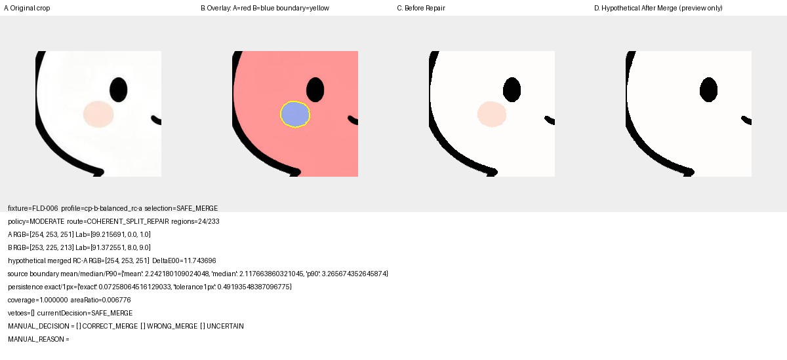
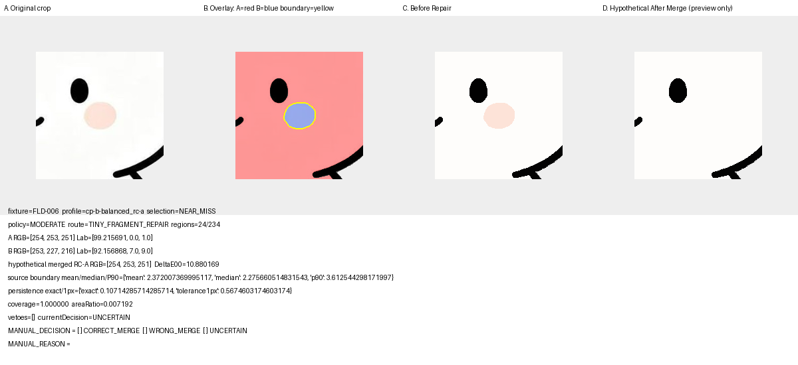
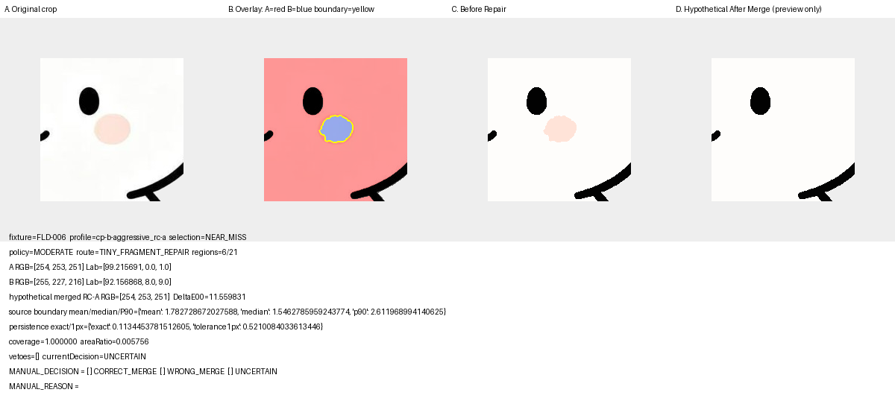
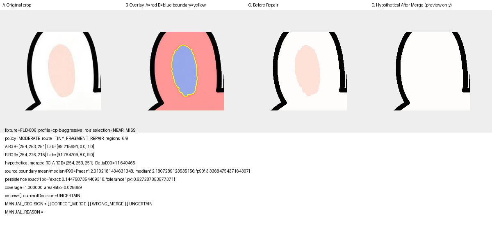
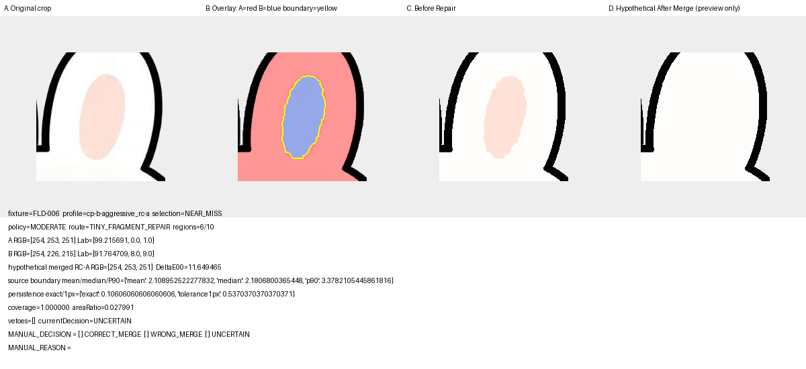
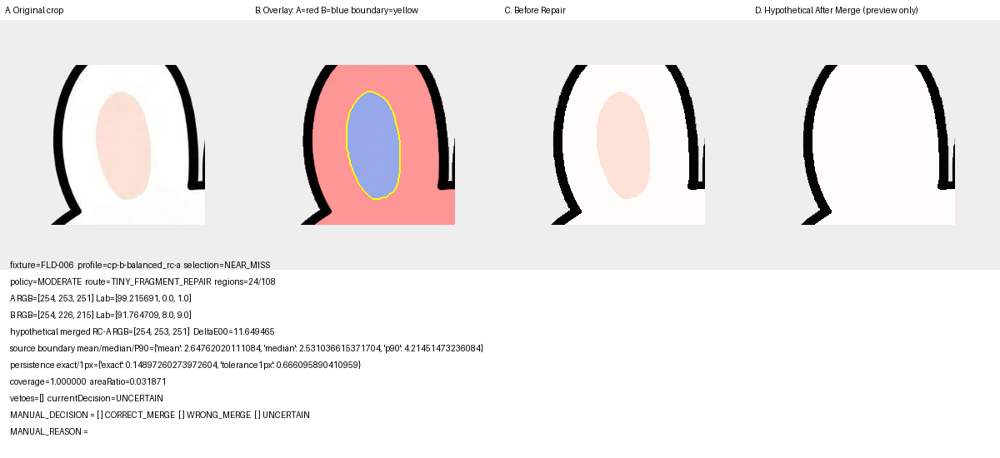
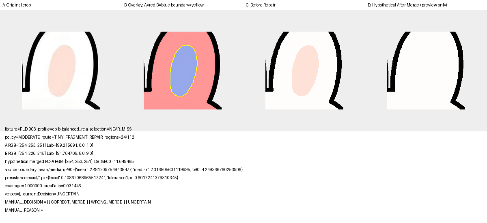
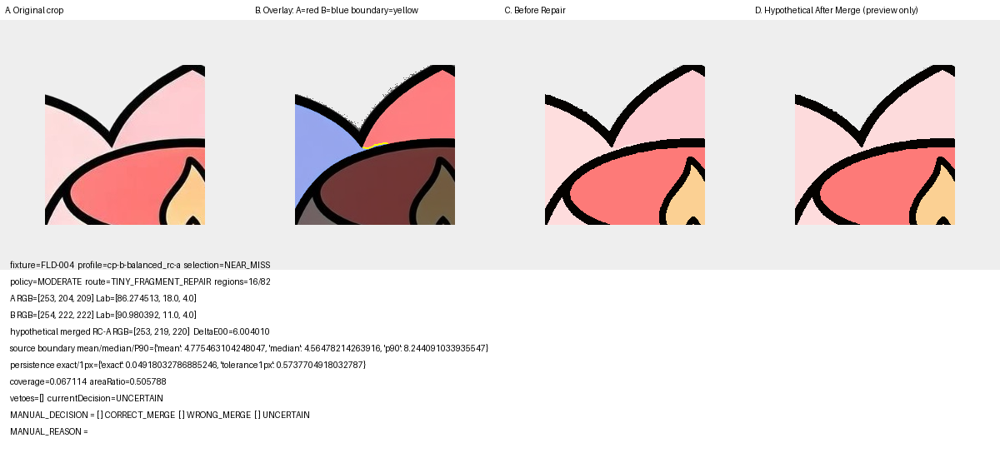
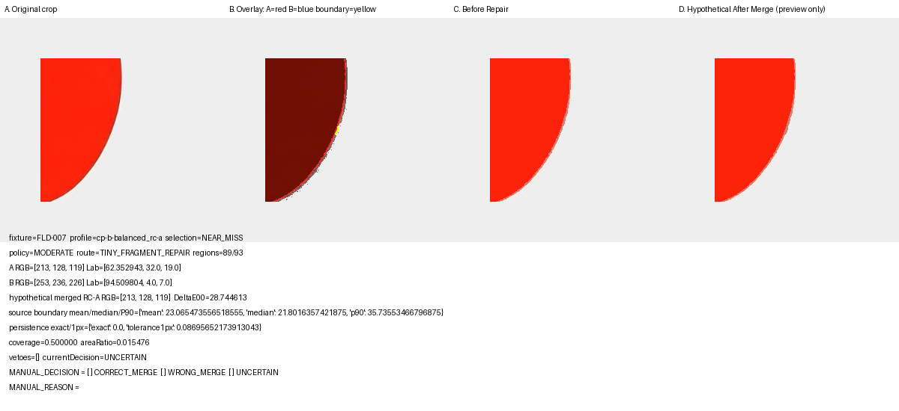

# Project-real SAFE_MERGE Manual Review

Gate 2 V2 remains `PENDING_EXTERNAL_GATE_2_REVIEW_V2`. Repair Apply remains `NOT_EXECUTED`.

This packet contains project-real evidence only. Hypothetical merge panels are disposable previews and do not modify B1 or Region Core artifacts.

- SAFE_MERGE candidates: `2`
- High-risk near misses: `8`
- Contact sheet: [PROJECT_REAL_SAFE_MERGE_CONTACT_SHEET.png](PROJECT_REAL_SAFE_MERGE_CONTACT_SHEET.png)

## 01-FLD-006-cp-b-balanced_rc-a-r24-r233-moderate

- Selection: `SAFE_MERGE`; policy: `MODERATE`; route: `COHERENT_SPLIT_REPAIR`
- Regions: `24` / `233`; decision: `SAFE_MERGE`; vetoes: `[]`
- ΔE00: `11.743696`; boundary: `{'mean': 2.242180109024048, 'median': 2.117663860321045, 'p90': 3.265674352645874}`
- Persistence: `{'exact': 0.07258064516129033, 'tolerance1px': 0.49193548387096775}`; coverage: `1.000000`; area ratio: `0.006776`
- MANUAL_DECISION: `[ ] CORRECT_MERGE  [ ] WRONG_MERGE  [ ] UNCERTAIN`
- MANUAL_REASON:
## 02-FLD-006-cp-b-aggressive_rc-a-r6-r22-moderate

- Selection: `SAFE_MERGE`; policy: `MODERATE`; route: `COHERENT_SPLIT_REPAIR`
- Regions: `6` / `22`; decision: `SAFE_MERGE`; vetoes: `[]`
- ΔE00: `11.743696`; boundary: `{'mean': 2.0335590839385986, 'median': 2.167299747467041, 'p90': 3.3813083171844482}`
- Persistence: `{'exact': 0.07692307692307693, 'tolerance1px': 0.49145299145299143}`; coverage: `1.000000`; area ratio: `0.005257`
- MANUAL_DECISION: `[ ] CORRECT_MERGE  [ ] WRONG_MERGE  [ ] UNCERTAIN`
- MANUAL_REASON:
## 03-FLD-006-cp-b-balanced_rc-a-r24-r234-moderate

- Selection: `NEAR_MISS`; policy: `MODERATE`; route: `TINY_FRAGMENT_REPAIR`
- Regions: `24` / `234`; decision: `UNCERTAIN`; vetoes: `[]`
- ΔE00: `10.880169`; boundary: `{'mean': 2.372007369995117, 'median': 2.275660514831543, 'p90': 3.612544298171997}`
- Persistence: `{'exact': 0.10714285714285714, 'tolerance1px': 0.5674603174603174}`; coverage: `1.000000`; area ratio: `0.007192`
- MANUAL_DECISION: `[ ] CORRECT_MERGE  [ ] WRONG_MERGE  [ ] UNCERTAIN`
- MANUAL_REASON:

## 04-FLD-006-cp-b-aggressive_rc-a-r6-r21-moderate

- Selection: `NEAR_MISS`; policy: `MODERATE`; route: `TINY_FRAGMENT_REPAIR`
- Regions: `6` / `21`; decision: `UNCERTAIN`; vetoes: `[]`
- ΔE00: `11.559831`; boundary: `{'mean': 1.782728672027588, 'median': 1.5462785959243774, 'p90': 2.611968994140625}`
- Persistence: `{'exact': 0.1134453781512605, 'tolerance1px': 0.5210084033613446}`; coverage: `1.000000`; area ratio: `0.005756`
- MANUAL_DECISION: `[ ] CORRECT_MERGE  [ ] WRONG_MERGE  [ ] UNCERTAIN`
- MANUAL_REASON:

## 05-FLD-006-cp-b-aggressive_rc-a-r6-r9-moderate

- Selection: `NEAR_MISS`; policy: `MODERATE`; route: `TINY_FRAGMENT_REPAIR`
- Regions: `6` / `9`; decision: `UNCERTAIN`; vetoes: `[]`
- ΔE00: `11.649465`; boundary: `{'mean': 2.0102181434631348, 'median': 2.1807289123535156, 'p90': 3.3368475437164307}`
- Persistence: `{'exact': 0.1447587354409318, 'tolerance1px': 0.627287853577371}`; coverage: `1.000000`; area ratio: `0.028689`
- MANUAL_DECISION: `[ ] CORRECT_MERGE  [ ] WRONG_MERGE  [ ] UNCERTAIN`
- MANUAL_REASON:

## 06-FLD-006-cp-b-aggressive_rc-a-r6-r10-moderate

- Selection: `NEAR_MISS`; policy: `MODERATE`; route: `TINY_FRAGMENT_REPAIR`
- Regions: `6` / `10`; decision: `UNCERTAIN`; vetoes: `[]`
- ΔE00: `11.649465`; boundary: `{'mean': 2.108952522277832, 'median': 2.1806800365448, 'p90': 3.3782105445861816}`
- Persistence: `{'exact': 0.10606060606060606, 'tolerance1px': 0.5370370370370371}`; coverage: `1.000000`; area ratio: `0.027991`
- MANUAL_DECISION: `[ ] CORRECT_MERGE  [ ] WRONG_MERGE  [ ] UNCERTAIN`
- MANUAL_REASON:

## 07-FLD-006-cp-b-balanced_rc-a-r24-r108-moderate

- Selection: `NEAR_MISS`; policy: `MODERATE`; route: `TINY_FRAGMENT_REPAIR`
- Regions: `24` / `108`; decision: `UNCERTAIN`; vetoes: `[]`
- ΔE00: `11.649465`; boundary: `{'mean': 2.64762020111084, 'median': 2.531036615371704, 'p90': 4.21451473236084}`
- Persistence: `{'exact': 0.14897260273972604, 'tolerance1px': 0.666095890410959}`; coverage: `1.000000`; area ratio: `0.031871`
- MANUAL_DECISION: `[ ] CORRECT_MERGE  [ ] WRONG_MERGE  [ ] UNCERTAIN`
- MANUAL_REASON:

## 08-FLD-006-cp-b-balanced_rc-a-r24-r112-moderate

- Selection: `NEAR_MISS`; policy: `MODERATE`; route: `TINY_FRAGMENT_REPAIR`
- Regions: `24` / `112`; decision: `UNCERTAIN`; vetoes: `[]`
- ΔE00: `11.649465`; boundary: `{'mean': 2.4812097549438477, 'median': 2.316805601119995, 'p90': 4.249366760253906}`
- Persistence: `{'exact': 0.10862068965517241, 'tolerance1px': 0.6017241379310345}`; coverage: `1.000000`; area ratio: `0.031446`
- MANUAL_DECISION: `[ ] CORRECT_MERGE  [ ] WRONG_MERGE  [ ] UNCERTAIN`
- MANUAL_REASON:

## 09-FLD-004-cp-b-balanced_rc-a-r16-r82-moderate

- Selection: `NEAR_MISS`; policy: `MODERATE`; route: `TINY_FRAGMENT_REPAIR`
- Regions: `16` / `82`; decision: `UNCERTAIN`; vetoes: `[]`
- ΔE00: `6.004010`; boundary: `{'mean': 4.775463104248047, 'median': 4.56478214263916, 'p90': 8.244091033935547}`
- Persistence: `{'exact': 0.04918032786885246, 'tolerance1px': 0.5737704918032787}`; coverage: `0.067114`; area ratio: `0.505788`
- MANUAL_DECISION: `[ ] CORRECT_MERGE  [ ] WRONG_MERGE  [ ] UNCERTAIN`
- MANUAL_REASON:

## 10-FLD-007-cp-b-balanced_rc-a-r89-r93-moderate

- Selection: `NEAR_MISS`; policy: `MODERATE`; route: `TINY_FRAGMENT_REPAIR`
- Regions: `89` / `93`; decision: `UNCERTAIN`; vetoes: `[]`
- ΔE00: `28.744613`; boundary: `{'mean': 23.065473556518555, 'median': 21.8016357421875, 'p90': 35.73553466796875}`
- Persistence: `{'exact': 0.0, 'tolerance1px': 0.08695652173913043}`; coverage: `0.500000`; area ratio: `0.015476`
- MANUAL_DECISION: `[ ] CORRECT_MERGE  [ ] WRONG_MERGE  [ ] UNCERTAIN`
- MANUAL_REASON: <!-- intentionally blank -->
